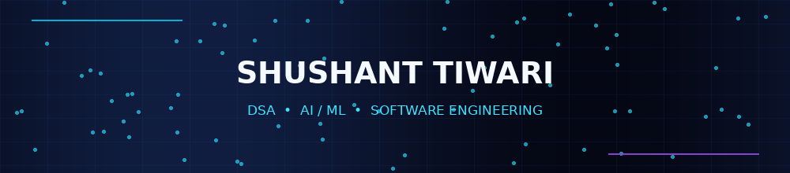
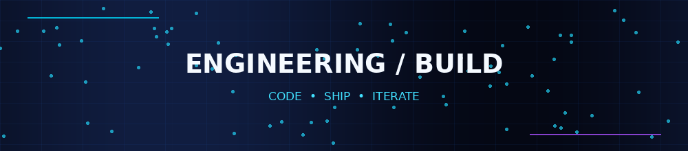
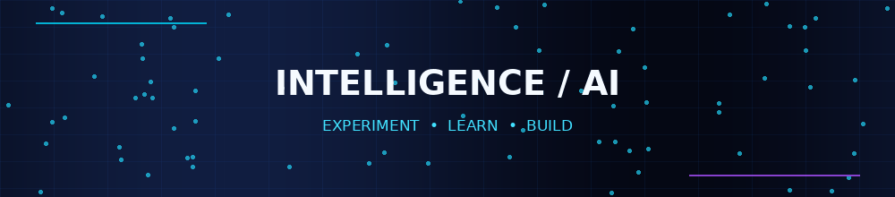
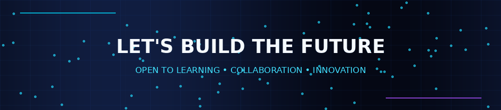

<div align="center">




<a href="https://github.com/Shushant-556"></a>
<a href="https://github.com/Shushant-556?tab=followers"></a>
<a href="https://leetcode.com/u/shushant_556/"></a>

</div>

---



## 01 / PROFILE

```text
NAME        Shushant Tiwari
EDUCATION   B.Tech · Computer Science & Engineering
UNIVERSITY IILM University, Greater Noida
GRADUATION  2028
CGPA        9.30
FOCUS       DSA · AI/ML · Software Development
```

Computer Science undergraduate interested in **algorithmic problem-solving, artificial intelligence, and software engineering**. I like understanding systems deeply and turning ideas into practical applications.

> **Think rigorously. Build thoughtfully. Improve continuously.**

---

## 02 / TECH STACK

<div align="center">


<br/><br/>

<br/><br/>


</div>

---



## 03 / FEATURED PROJECTS

<table>
<tr>
<td width="50%" valign="top">

### 🌦️ Hyperlocal Weather & Extreme Event Forecasting
**Machine Learning · Weather · Air Quality**

- Delhi hyperlocal weather and pollution forecasting pipeline.
- Temperature, PM2.5 and PM10 prediction.
- Fog detection through meteorological thresholds.
- Extreme weather and pollution-event classification.

**Tools:** Python · Pandas · NumPy · ML

</td>
<td width="50%" valign="top">

### 🛍️ PlaceWise AI
**AI-Powered Product Visualization**

- Product visualization in real-world environments before purchase.
- Live camera visualization, 3D models and AI placement assistance.
- Helps assess fit, appearance and available space.

**Focus:** AI · 3D · Product Experience

</td>
</tr>
<tr><td colspan="2" align="center">

### 🌐 NetSage AI
AI + Networking project in the Cisco VIP project context.

<a href="https://github.com/Shushant-556/NetSage-AI"></a>

</td></tr>
</table>

<div align="center"><a href="https://github.com/Shushant-556?tab=repositories"></a></div>

---

## 04 / PROBLEM SOLVING

<div align="center">
<a href="https://leetcode.com/u/shushant_556/"></a>
<br/>
<a href="https://leetcode.com/u/shushant_556/"></a>
</div>

---

## 05 / GITHUB TELEMETRY

<div align="center">


</div>

---

## 06 / CONTRIBUTION MATRIX

<div align="center">

</div>

---

## 07 / EXPERIENCE

### Campus Ambassador — IIT Delhi Rendezvous
`September 2025 – October 2025`
- Represented IIT Delhi Rendezvous events and initiatives through online and offline student engagement.

### Intern — She Can Foundation
`September 2025`
- Supported organizational initiatives, daily operations and fundraising efforts.

---

## 08 / CERTIFICATIONS

> Your resume lists certificate names but not actual credential URLs. Replace placeholders below with verified links to make each certificate clickable.

- [HP LIFE — AI Learning](CERTIFICATE_URL_HP_LIFE)
- [Oracle — Generative AI Professional](CERTIFICATE_URL_ORACLE)
- [TATA — GenAI Powered Data Analytics Job Simulation](CERTIFICATE_URL_TATA)
- [Exploring Blockchain](CERTIFICATE_URL_BLOCKCHAIN)
- [Introduction to Data Science](CERTIFICATE_URL_DATA_SCIENCE)
- [Harvard University — Introduction to Computer Science](CERTIFICATE_URL_HARVARD)

---

## 09 / NOW BUILDING

- **DSA:** strengthening fundamentals and problem-solving patterns
- **AI/ML:** exploring intelligent applications
- **Engineering:** improving code quality and software fundamentals
- **Projects:** building practical things and learning by shipping

---

## 10 / CONNECT

<div align="center">
<a href="https://github.com/Shushant-556"></a>
<a href="https://www.linkedin.com/in/shushant-tiwari"></a>
<a href="https://leetcode.com/u/shushant_556/"></a>
<a href="mailto:shushanttiwari2036@gmail.com"></a>
<br/><br/>

<sub>Designed with intent · Built with curiosity · Powered by persistence</sub>
</div>
